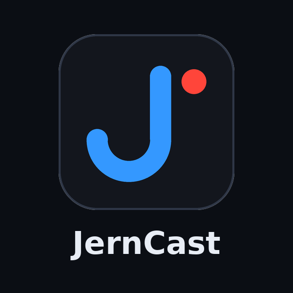

<p align="center"></p>

# JernCast 0.0.3

A simple screen recorder and live streamer for Windows 10/11, with a dark, dockable, OBS-style window.
JernCast is its own program: its code is original (MIT licensed) and it is not affiliated with OBS Studio.

## The window

A menu bar, a preview in the middle, and docks you can move:

| Dock | What it does |
| --- | --- |
| **Scenes** | Click a scene to switch to it, even while you record or stream. **+ − ▲ ▼** add, remove and reorder. Double-click or right-click to rename. |
| **Sources** | What is in the current scene: screen, a window, webcam, picture. Click the dot to show or hide a source live. **⚙** Properties, **▲ ▼** move forward or back. |
| **Audio Mixer** | One strip for **Desktop Audio**, one for **Mic/Aux**, plus any audio inputs you add. Each has a live level meter, a fader (0-200%) and a mute button. All work live. |
| **Controls** | **Start Streaming**, **Start Recording**, **Manage Broadcast** (opens YouTube's or Twitch's live control page), **Settings**, **Exit**. |
| **Recent recordings** | Off by default; turn it on in the **Docks** menu. |

**Moving docks:** drag a dock by its title bar to the left, right or bottom of the window (empty areas show "Drop a dock here").
**View > Lock Docks** stops them being moved, **View > Reset Docks** puts them back, the **✕** hides one, and the
**Docks** menu brings it back. Your layout is remembered.

**Menus:** File, View, Docks, **Profile** (separate sets of settings, for example "Streaming" and "Recording") and
**Scene Collection** (separate sets of scenes and sources), Tools, Help.

**Dragging in the preview:** click a source in the preview and drag it to move it, drag a corner to resize it (it
snaps to the edges and centre). This works **while you record or stream**: the change is sent to the running picture a
few times a second. Moved sources keep their place; **Properties** can put one back in a corner.

**Studio Mode** (Controls > Studio Mode, or View menu): the window shows **Preview** (the scene you are editing, with
drag handles) next to **Program** (what is really being recorded or streamed, live). Clicking a scene in Scenes chooses
what to edit; **Transition** (or **Ctrl+Alt+0**) sends it live as a cut, and the old Program scene moves into Preview so
you can go back. The Preview side is a layout sketch (boxes and names), not a second live picture.

**Virtual Camera** (Controls > Start Virtual Camera): other programs (Zoom, Discord, a browser) can then pick it as a
webcam. This needs a virtual camera **driver** installed on the PC, which JernCast cannot install for you: install
**OBS Studio** (its virtual camera is used) or **Unity Capture**, and the Python package `pyvirtualcam`
(`pip install pyvirtualcam`, or build the installer with the *include virtual camera* option). If something is
missing, JernCast tells you what. The picture is the same as the recording (Settings > Video sets its size), with
about a second of delay.

**Status bar:** REC and LIVE timers, plus JernCast's CPU use and memory use (including FFmpeg) and the frame rate.

The **preview** shows the real picture whenever you are recording or streaming, or when **View > Live Preview** is on
(that keeps capturing, so it uses CPU). Otherwise it shows a layout sketch of the scene.

Hotkeys (change them in Settings > Hotkeys): **F9** start/stop recording, **F10** start/stop streaming,
**Ctrl+Alt+1 to 9** switch to scene 1 to 9.

Streaming and recording are separate: start either first, stop either without stopping the other. If the internet
drops, the stream ends and you are told, but the recording keeps going. Recordings are saved as they happen
(safe if the PC crashes) and become MP4 when you stop.

## Get it

### Easiest: build the installer on GitHub (nothing to install on your PC)

1. Make a **public** GitHub repository and upload everything in this folder.
2. Open the **Actions** tab, choose **JernCast Windows installer**, press **Run workflow**.
3. After about 5 to 10 minutes open the run and download **Jerncast-0.0.3-Setup** (bottom of the page, Artifacts).

### Or run it without building

1. Install Python 3.10 or newer from https://www.python.org/downloads/ and tick **Add python.exe to PATH**.
2. Double-click **run.bat**. The first time it downloads FFmpeg (about 150 MB). For desktop sound also run
   `pip install pyaudiowpatch` once.

### Or build the installer on your own PC

```powershell
scripts\build-windows.ps1 -Installer     # needs Python, and Inno Setup 6 for the installer
```

## First steps

1. Open **Settings > Audio** and choose **Desktop Audio** (System sound) and your **Mic/Aux**.
2. In **Sources** press **+** to add a **Display capture**, **Window capture** or **Webcam**.
3. Press **Start Recording**. Click between scenes in **Scenes** while it runs. Press it again to stop;
   the MP4 is in `Videos\JernCast`.

## Going live on YouTube

1. YouTube Studio > **Create > Go live > Stream**, copy the **Stream key**.
2. In JernCast open **Settings > Stream**, pick **YouTube**, paste the key. Under **Video** use **720p**
   and under **Output** a bitrate of **4500** (use **480p** and **2500** on a slow connection).
3. Press **Start Streaming**. JernCast tells you if YouTube cannot be reached.
4. Press **Manage Broadcast** to open YouTube's control page and press its own **Go live** when the preview looks good.

Your stream key is saved on your PC only (untick *Remember the stream key* in Settings > Stream to not save it) and
is hidden in logs and messages. Your upload speed must be higher than the bitrate.

## Using little memory

While nothing is recording JernCast runs no FFmpeg at all, and the window wakes up only twice a second. While recording
it runs one FFmpeg (a second only while streaming) and writes the recording straight to disk. Measured with test video
(1080p screen, 720p webcam, several scenes, two audio inputs; the virtual camera adds one more decoder process while it is on) the FFmpeg engine used about **125 MB** at 720p and about
**85 MB** at 480p with quality *low*. The status bar shows the real figure on your PC. For the least memory and CPU:
**480p**, quality **low**, **30 fps**, few sources, and Live Preview off.

## What is not in 0.0.3

- **Scene Transitions** (fade between scenes): scene changes are instant cuts. FFmpeg accepts only about ten live
  commands a second, which is too few for a smooth fade, so the dock is left out rather than half-working.
- Source filters, replay buffer, fade transitions in Studio Mode (Transition is a cut).
- **Virtual Camera** has only been tested here with a stand-in camera. The real thing needs the driver and package
  described above, and it has not been run on a real Windows PC.
- **Desktop Audio** uses Windows loopback through the `pyaudiowpatch` package (included in the installer build). It has
  not been run on a real Windows PC yet; if it fails, pick Stereo Mix or a virtual cable in Settings > Audio.
- Changes to sources and scenes are made while stopped; switching scenes, showing or hiding sources, volume and mute
  work live. Every source in every scene is captured while running (that is what makes switching instant).
- Window capture records the window's size at the moment you start; protected video windows record black.
- Logs and settings: `%LOCALAPPDATA%\JernCast` (Tools > Open Logs Folder).

## For developers

`python -m unittest discover -s tests` runs the tests with real FFmpeg and generated test sources (any OS; the window's
tests use a stand-in for tkinter, so they check what the buttons and menus do, not how the window looks).

- `core.py` settings, devices, encoders · `project.py` scenes, sources and the FFmpeg graph · `namedstore.py` profiles and collections · `placement.py` drag maths · `preview.py` the preview area · `vcam.py` virtual camera
- `engine.py` the running FFmpeg and its outputs · `session.py` what the buttons call · `loopback.py` system sound · `sysinfo.py` CPU and memory
- `docklayout.py` where the docks are (pure logic) · `dockui.py` dragging and arranging · `gui.py` the window ·
  `dialogs.py` Settings and Properties · `widgets.py` hand-drawn buttons, switches, faders, meters · `winutil.py` monitors, windows, hotkeys

One FFmpeg captures every source, draws every scene, mixes the audio and encodes once. Scene changes, visibility, volume
and mute are commands sent to that running FFmpeg. Its output is relayed to the recording file and, when streaming, to a
small `ffmpeg -c copy` process, so each can start and stop alone.

MIT licensed, see `LICENSE`. Third-party notices in `THIRD_PARTY.md`.
