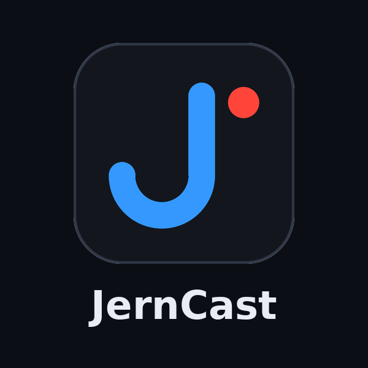

<p align="center"></p>

# JernCast 0.0.2

A simple screen recorder and live streamer for Windows 10/11. Pick what to capture, press
**Start Recording** or **Go live**.

## What is in the window

| Card | What it does |
| --- | --- |
| **Capture** | Screen, or a single window. 30 or 60 fps. Stop after N minutes. Output folder and file name. |
| **Stream** | YouTube, Twitch or a custom server, and your stream key. Tells you if the key is missing. |
| **Recent recordings** | Your last recordings. Double-click to open. |
| **Audio & Webcam** | Microphone and desktop sound, each with a level slider, an On switch and a live level meter. Webcam, its corner and its size. A **Layout** switch. |
| **Advanced** | Encoder (your graphics card is used when it works), output size 480p / 720p / 1080p, quality, top bitrate, hotkeys, show cursor, MP4, whether to remember the stream key. |

Bottom: **Start Recording**, **Go live**, **Manage Broadcast** (opens YouTube's or Twitch's live control page).
**Compact** (top right) turns the window into a small live preview with level meters and layout buttons.

### Four layouts, switched live

1. Screen only 2. Screen + webcam in a corner 3. Webcam only 4. Webcam full with the screen small

Change them from the Layout box, the **1 2 3 4** buttons in Compact view, or with **Ctrl+Alt+1 to 4**.
This works while you are recording or live. (They need a webcam chosen; without one there is just layout 1.)

Hotkeys: **F9** start/stop recording, **F10** go live / stop (changeable under Advanced).

Streaming and recording are separate: start either first, stop either without stopping the other. If the
internet drops, the stream ends and you are told, but the recording keeps going.
Recordings are saved as MKV while recording (safe if the PC crashes) and become MP4 when you stop.

## Get it

### Easiest: build the installer on GitHub (nothing to install on your PC)

1. Make a **public** GitHub repository and upload everything in this folder.
2. Open the **Actions** tab, choose **JernCast Windows installer**, press **Run workflow**.
3. After about 5 to 10 minutes open the run and download **Jerncast-0.0.2-Setup** (bottom of the page, Artifacts).

### Or run it without building

1. Install Python 3.10 or newer from https://www.python.org/downloads/ and tick **Add python.exe to PATH**.
2. Double-click **run.bat**. The first time it downloads FFmpeg (about 150 MB). For desktop sound also run
   `pip install pyaudiowpatch` once.

### Or build the installer on your own PC

```powershell
scripts\build-windows.ps1 -Installer     # needs Python, and Inno Setup 6 for the installer
```

## Going live on YouTube

1. YouTube Studio > **Create > Go live > Stream**, copy the **Stream key**.
2. In JernCast, **Stream** card: service **YouTube**, paste the key. Under **Advanced** use output **720p**
   and bitrate **4500** (use **480p** and **2500** on a slow connection).
3. Press **Go live**. JernCast tells you if YouTube cannot be reached.
4. Press **Manage Broadcast** to open YouTube's control page and press its own **Go live** when the preview looks good.

Your stream key is saved on your PC only (untick *Remember stream key* under Advanced to not save it) and is
hidden in logs and messages. Your upload speed must be higher than the bitrate.

## Notes and limits (version 0.0.2)

- **Desktop sound** ("System sound") is captured with Windows' loopback, using the `pyaudiowpatch` package that the
  installer includes. If it is missing, JernCast says so; then pick **Stereo Mix** (Sound settings > Recording
  devices > Show disabled devices) or a virtual audio cable instead. This part has not been run on a real Windows PC yet.
- **Live preview** is in Compact view. It keeps the screen being captured while you look at it, which uses CPU;
  on a slow PC switch back to the full view when you do not need it.
- Source, size, quality and device changes apply when you next press Start. Layout, mic/desktop level and On switches
  work live.
- Every source in every layout is captured while running (that is what makes switching instant).
- No replay buffer, green screen or crop yet.
- Window capture records the window's size at the moment you start; protected video windows record black.
  If a webcam will not start, close other apps using it.
- Logs and settings: `%LOCALAPPDATA%\JernCast` (Advanced > Open logs folder).

## For developers

`python -m unittest discover -s tests` runs the tests with real FFmpeg and generated test sources (any OS; the
window's tests use a stand-in for tkinter, so they check what the buttons do, not how the window looks).

- `core.py` settings, devices, encoders · `layouts.py` window choices to scenes · `project.py` scenes and the FFmpeg graph
- `engine.py` the running FFmpeg and its outputs · `session.py` what the buttons call · `loopback.py` system sound
- `gui.py` the window · `winutil.py` monitors, windows, hotkeys

One FFmpeg captures every source, draws every layout, mixes the audio and encodes once. Layout changes, levels and
mute are commands sent to that running FFmpeg. Its output is relayed to small `ffmpeg -c copy` processes, one saving
the file and one sending the stream, so each can start and stop alone.

MIT licensed, see `LICENSE`. Third-party notices in `THIRD_PARTY.md`.
